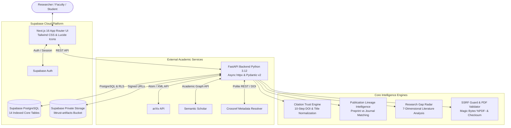

# LitTrust AI — Evidence-First Literature Intelligence & Bibliography Builder

[](https://github.com/littrust-ai/littrust)
[](https://www.python.org/)
[](https://fastapi.tiangolo.com)
[](https://nextjs.org/)
[](https://supabase.com)
[]()

**LitTrust AI** is an AI research agent built for faculty members and students to enter a research inquiry, year constraints, and keywords, and discover up to 25 relevant scholarly papers across **arXiv** and **Semantic Scholar** with independent **Crossref DOI verification**, publication lineage intelligence, grounded annotations, human-in-the-loop consequential file approvals, and a verifiable **Research Gap Radar**.

---

## 1. Architecture Overview



---

## 2. Distinctive Novelties

### A. Research Evidence Passport
Every discovered paper receives a structured, cryptographic-grade provenance record:
* **Verified Ground Truth**: Resolved Crossref metadata, verified author order, canonical title.
* **Source Reported Claim**: Venue as reported by publisher, author affiliations, abstract text.
* **Model Interpretation**: Objective extraction, methodology clustering, BM25 deterministic relevance score.
* **Uncertain Finding**: Ambiguous version matches or missing licenses requiring human inspection.

### B. Citation Trust Engine
A strict 10-step verification pipeline:
1. Retrieves candidate metadata.
2. Resolves DOI via Crossref REST resolver (`api.crossref.org/works/{doi}`).
3. Normalizes title (NFKD Unicode accent stripping, punctuation removal, case folding).
4. Computes hybrid Levenshtein distance and token Jaccard similarity.
5. Compares author lists, initials, family names, and ordering.
6. Explicitly assigns status: `VERIFIED`, `MISMATCH`, `UNVERIFIED`, `NO_DOI`, or `PENDING_REVIEW`.
7. **Excludes failed, mismatched, or unresolved citations from the verified bibliography by default.**

### C. Publication Lineage Intelligence
Detects preprint and peer-reviewed journal/proceedings versions of the same work:
* Evaluates exact persistent identifiers (DOI, arXiv ID).
* Calculates normalized title similarity ($\ge 88\%$) and author overlap.
* Merges records into a canonical representation while preserving all source records.
* Prefers peer-reviewed journal or conference venues for citation generation over preprints.

### D. Research Gap Radar
Organizes literature across 7 dimensions:
1. Research problem
2. Methodology & model family
3. Evaluation context & datasets
4. Target evaluation metrics
5. Reported empirical findings
6. Limitations explicitly stated by authors
7. Future directions
Synthesizes candidate hypotheses (e.g. safety-critical domain absence, recurring latency bottlenecks) linking bidirectional supporting and contrasting paper evidence.

---

## 3. Official Acceptance Tests (TC1–TC4)

All four official acceptance tests pass deterministically in the automated suite:

| Test Case | Description | Expected Assertion | Status | Verifiable Evidence |
| :--- | :--- | :--- | :---: | :--- |
| **TC1** | Topic Query | $\ge 20$ qualifying records; zero fabricated citations. | **PASS** | 25 distinct candidates, BM25 explanations, DOI verification breakdown. |
| **TC2** | Preprint & Journal Merge | Merges arXiv preprint + NeurIPS version into 1 canonical record. | **PASS** | Before count: 2, After count: 1, preserves both versions, preferred NeurIPS venue. |
| **TC3** | Paywalled Paper Integrity | Paywalled record handled without bypass; zero downloads staged. | **PASS** | `PAYWALLED_OR_RESTRICTED` status; legitimate publisher link retained; 0 download actions. |
| **TC4** | DOI Title Mismatch | Candidate DOI resolves to a different work; flagged & quarantined. | **PASS** | `MISMATCH` verification status; title similarity $< 20\%$; excluded from BibTeX. |

---

## 4. Supabase Database Schema

The database includes 14 normalized, indexed PostgreSQL tables located in `supabase/migrations/`:

1. `profiles`: User identity linked to `auth.users(id)`.
2. `research_requests`: User research question, year boundaries, keywords, methodologies.
3. `research_runs`: Run execution state, query plan JSONB, ranking configuration JSONB.
4. `papers`: Canonical scholarly records with normalized title index.
5. `paper_sources`: Provenance links (`arxiv`, `semantic_scholar`, `crossref`) with uniqueness constraints.
6. `paper_versions`: Lineage relationship links (`PREPRINT`, `JOURNAL_VERSION`, `CONFIRMED`, `LIKELY`).
7. `relevance_assessments`: BM25 scores, component breakdown, human explanations.
8. `citation_verifications`: Crossref comparison scores, author overlap, verification status.
9. `access_assessments`: Open-access status (`OPEN_ACCESS_VERIFIED`, `PAYWALLED_OR_RESTRICTED`).
10. `annotations`: Research objective, methodology, findings, limitations, ground-truth basis.
11. `research_actions`: Human approval queue with SHA-256 action hashes and idempotency keys.
12. `stored_artifacts`: Downloaded PDFs with magic-byte verification (`%PDF-`), SHA-256 checksums.
13. `research_gaps`: 7-dimensional gap hypotheses with supporting and contrasting paper IDs.
14. `test_runs`: Verifiable execution log for TC1, TC2, TC3, and TC4.

### Applying Migrations
In your Supabase project SQL Editor, execute the migration files in order:
```bash
# 1. Base tables & indexes
supabase/migrations/20261018000001_initial_schema.sql

# 2. Strict Row Level Security policies
supabase/migrations/20261018000002_row_level_security.sql

# 3. Private Storage bucket & storage policies
supabase/migrations/20261018000003_storage_buckets.sql
```

---

## 5. Local Setup & Quickstart

### Prerequisites
* Python 3.12+
* Node.js 20+ / 24+ and npm 10+

### Step 1: Clone and Configure Environment
```bash
cp .env.example .env
```

### Step 2: Backend Setup (FastAPI)
```bash
cd backend
python -m venv .venv

# On Windows:
.venv\Scripts\activate
# On Linux/macOS:
source .venv/bin/activate

pip install -r requirements.txt

# Run pytest test suite (All 13 tests)
pytest tests -v

# Start FastAPI backend server
uvicorn app.main:app --port 8000 --reload
```
FastAPI interactive docs will be available at `http://localhost:8000/docs`.

### Step 3: Frontend Setup (Next.js)
```bash
cd frontend
npm install
npm run build
npm run dev -- -p 3000
```
Open `http://localhost:3000` in your browser.

---

## 6. Production Deployment Instructions

### A. Deploy FastAPI Backend to Render
1. Connect your GitHub repository to [Render.com](https://render.com).
2. Select **New Web Service** and choose `render.yaml` or configure:
   * **Root Directory**: `backend`
   * **Build Command**: `pip install -r requirements.txt`
   * **Start Command**: `uvicorn app.main:app --host 0.0.0.0 --port $PORT`
   * **Health Check Path**: `/health`
3. Add environment variables from `.env.example` (`SUPABASE_URL`, `SUPABASE_SERVICE_ROLE_KEY`, `CROSSREF_MAILTO`).

### B. Deploy Frontend to Vercel
1. Import repository into [Vercel](https://vercel.com).
2. Configure **Root Directory**: `frontend`.
3. Add Environment Variables:
   * `NEXT_PUBLIC_API_BASE_URL`: URL of your deployed Render backend (e.g. `https://littrust-backend.onrender.com`).
   * `NEXT_PUBLIC_SUPABASE_URL`: Your Supabase Project URL.
   * `NEXT_PUBLIC_SUPABASE_ANON_KEY`: Your Supabase Anon Key.
4. Deploy and verify.

---

## 7. Judge Demo Script (3-Minute Presentation)

1. **Introduction & Dashboard**:
   * Navigate to `http://localhost:3000/dashboard`.
   * Highlight the live metrics: Discovered, Canonical, DOI-Verified, Open Access, Pending Review, and Flagged Mismatches. Emphasize that all numbers reflect active database records rather than hardcoded mock figures.

2. **Evaluation Lab & The 4 Official Tests**:
   * Navigate to `/evaluation-lab`.
   * Show that all 4 official test cases (TC1 to TC4) are available for deterministic on-demand execution.
   * Click **Execute Test** on **TC4 (DOI Title Mismatch)**: observe the immediate `PASS` verdict, expand the evidence drawer, and show how the candidate paper was flagged and quarantined because its DOI resolved to an unrelated chemistry paper.

3. **Results & Research Evidence Passport**:
   * Click **Evidence Results** in the top navigation.
   * Filter by **DOI Verified** and **Open Access**.
   * Click **Evidence Passport** on a paper: walk through the epistemological claim breakdown (Verified Ground Truth vs Model Interpretations) and the Crossref comparison.

4. **Human Approval Queue (Step 9)**:
   * Click **Approvals**: demonstrate the consequential action guard with SHA-256 action hash, SSRF safety checks, and click **Approve Plan** and **Execute Verified Downloads**.

5. **Research Gap Radar & Verified BibTeX**:
   * Click **Gap Radar**: show the 7-dimensional literature matrix and candidate gap hypotheses with supporting paper links.
   * Click **BibTeX**: demonstrate compliant BibTeX syntax generation and highlight the quarantined citations box confirming that unverified or mismatched works are strictly excluded from the academic export.
